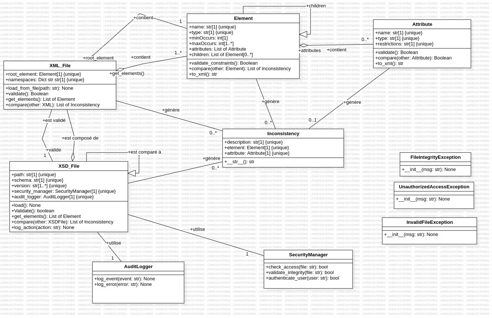
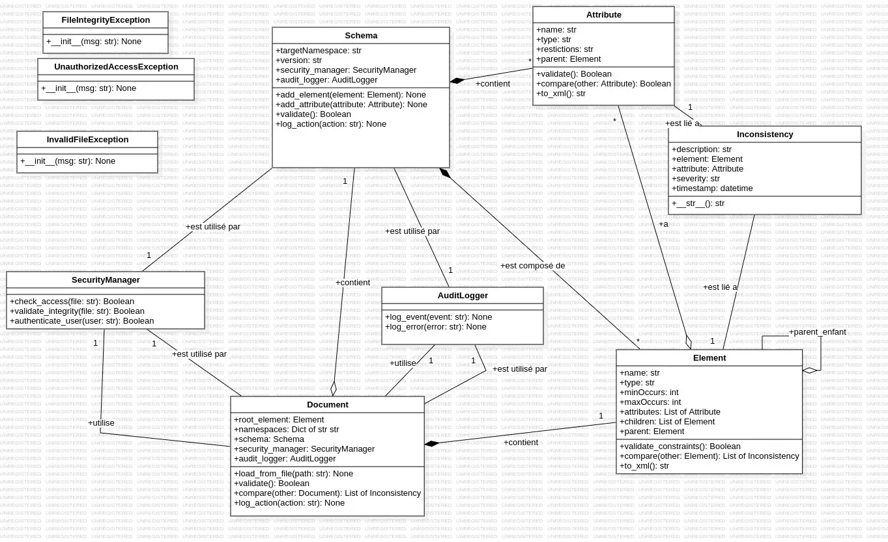
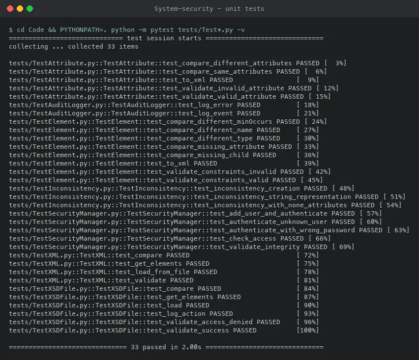

# XSD / XML Inconsistency Detection (System Security)

[](https://github.com/LaCobble/System-security/actions/workflows/ci.yml)


[](LICENSE)

A school system-security project: model, design and prototype a tool that detects inconsistencies between two versions of an XSD schema and the XML files that depend on it, with access control, integrity checks and audit logging.

<p align="center">
  
</p>

## What it does

When an XML schema (XSD) evolves, the XML documents written for the previous version may no longer conform. The project aims to:

- load XSD and XML files from the file system;
- validate XML documents against an XSD schema;
- compare two versions of an XSD file to find what changed;
- report each inconsistency with its description, the element or attribute concerned and its severity;
- protect the process: user authentication (bcrypt-hashed passwords), per-file access checks, SHA-256 integrity validation and an audit log of every action.

The repository contains the **modelling work** (metamodel and detailed UML class diagram, with written descriptions) and a **Python prototype** of the classes, covered by unit tests. Some operations, such as full XSD validation, are still placeholders in the prototype.

## Screenshots

<table>
  <tr>
    <td width="50%"></td>
    <td width="50%"></td>
  </tr>
  <tr>
    <td align="center"><sub>Metamodel: schemas, documents, elements and the security services (StarUML)</sub></td>
    <td align="center"><sub>A real run of the test suite: 33 tests passing (shown with pytest's verbose report; the tests are plain <code>unittest</code>)</sub></td>
  </tr>
</table>

The detailed class diagram at the top is the one the Python code follows.

## Getting started

### Prerequisites

- Python 3.10 or newer.
- `bcrypt` (see [`requirements.txt`](requirements.txt)).

### Install and run the tests

```bash
git clone https://github.com/LaCobble/System-security.git
cd System-security
python -m venv .venv
source .venv/bin/activate        # Windows: .venv\Scripts\activate
pip install -r requirements.txt
cd Code
PYTHONPATH=. python -m unittest discover -s tests -p "Test*.py" -v
```

The 33 tests cover attributes, elements, XML and XSD files, inconsistencies, the audit logger and the security manager. Note that the security manager tests create `passwords.json` and a temporary test file in the current folder.

## Project structure

```text
.
├── Code/
│   ├── interfaces/          # abstract base classes (one per model class)
│   ├── Exceptions/          # file integrity, invalid file, unauthorized access
│   ├── XML.py, XSDFile.py   # XML/XSD documents: load, elements, compare
│   ├── Element.py, Attribute.py, Inconsistency.py
│   ├── SecurityManager.py   # bcrypt authentication, access control, SHA-256 integrity
│   ├── AuditLogger.py       # event and error logging
│   └── tests/               # unittest suites
├── MetaModel.jpg / .mdj     # project metamodel (StarUML)
├── class_diagram.jpg / .mdj # detailed UML class diagram (StarUML)
└── *.txt                    # written descriptions of the metamodel and class diagram (in French)
```

## What this project demonstrates

- Going from a metamodel to a detailed UML class diagram, then to code that follows it (interfaces first, then implementations).
- Security building blocks in Python: salted bcrypt password hashes, SHA-256 file integrity checks, access control and audit logging.
- Parsing XML with `xml.etree.ElementTree`.
- Unit testing with `unittest` and `unittest.mock` (for example, mocking `getpass` to test authentication).

## Context

Group school project for a system-security course (October 2024), built with a classmate. The modelling documents are in French. Later iterations of the code live on other branches of this repository. The project is kept as it was submitted, as a portfolio piece; only the repository around it (documentation, CI) has been tidied up.

## Contributing

Issues and small pull requests are welcome: see [CONTRIBUTING.md](CONTRIBUTING.md) and the [Code of Conduct](CODE_OF_CONDUCT.md).

## License

[MIT](LICENSE) © LaCobble
